<!-- ============================== HEADER ============================== -->

  

  

  
  
  <!-- TODO: replace YOUR_HANDLE with your real Hashnode handle -->
  

  

---

<!-- ============================== TECH STACK ============================== -->
## 🛠️ Tech Stack

  

  

  
  
  
  
  

---

<!-- ============================== PROJECTS ============================== -->
## 🚀 Featured Projects

<table>
  <tr>
    <td width="50%" valign="top">
      <h3 align="center">⚙️ <a href="https://github.com/LoelStark/torque_token">Torque &amp; Token</a></h3>
      
Self-hosted AI platform for three sectors, including live machine monitoring with an offline-safe edge buffer for manufacturing, plus photo-based condition and value appraisal.

      

        
        
        
        
      

    </td>
    <td width="50%" valign="top">
      <h3 align="center">🧠 <a href="https://github.com/LoelStark/life-long-learn">Life Long Learn</a></h3>
      
Personal AI study assistant. A Flask + Ollama backend turns academic records into personalised study plans, custom quizzes and learning strategies based on a learning-style assessment.

      

        
        
        
      

    </td>
  </tr>
  <tr>
    <td width="50%" valign="top">
      <h3 align="center">🕵️ <a href="https://github.com/LoelStark/Cyber-Labs">Cyber-Labs</a></h3>
      
An interactive, compiled guide to breaking into cybersecurity with a built-in tasklist you can tick off as you go. Contributions welcome.

      

        
        
        
      

    </td>
    <td width="50%" valign="top">
      <h3 align="center">🤖 Smart Pen Prototype</h3>
      
Embedded AI smart pen with an ESP32-C3 microcontroller, OLED display and speech processing.

      

        
        
        
      

    </td>
  </tr>
  <tr>
    <td width="50%" valign="top">
      <h3 align="center">♻️ Waste Sorting RVM</h3>
      
Automated waste sorting prototype with storage-level sensors and a rewards mechanism.

      

        
        
        
      

    </td>
    <td width="50%" valign="top">
      <h3 align="center">☀️ Solar MPPT Charging Station</h3>
      
550W solar power assembly built for active battery management and energy conversion optimisation.

      

        
        
      

    </td>
  </tr>
  <tr>
    <td width="50%" valign="top">
      <h3 align="center">💡 Local AI Finance Tracker</h3>
      
Terminal-based finance tracker that runs fully offline on local Ollama models.

      

        
        
        
      

    </td>
    <td width="50%" valign="top">
      <h3 align="center">🍓 Pilot.config</h3>
      
A guide to n8n and automation on a Raspberry Pi 5, written up on my Hashnode blog.

      

        
        
      

    </td>
  </tr>
</table>

  

---

<!-- ============================== CERTIFICATIONS ============================== -->
## 🎓 Certifications &amp; Credentials

  

  
  
  
  
  
  
  
  
  
  

<b>📜 Full credential log (click to expand)</b>

 

| Date | Credential | Issuer | Focus |
|:--|:--|:--|:--|
| **Nov 2026** | Endpoint Security | Cisco Networking Academy | Endpoint &amp; network security |
| **Oct 2026** | Introduction to Data Science | Cisco Networking Academy | Data science |
| **Sep 2026** | Student Member | SAIEE | Electrical engineering, full-stack dev |
| **Jul 2026** | Introduction to Cybersecurity | Cisco Networking Academy | Linux, malware analysis |
| **Jun 2026** | Ethical Hacker | Cisco Networking Academy | Linux, ethical hacking |
| **Jun 2026** | CCNA: Introduction to Networks | Cisco Networking Academy | Networking, Linux |
| **Jan 2026** | Introduction to Generative AI (Training Badge) | AWS Educate | Generative AI |
| **Dec 2025** | Certified Cybersecurity Educator Professional (CCEP) | Red Team Leaders | Malware analysis |
| **Oct 2025** | Hackathon Organizing Committee | Vaal University of Technology | IT, Flask |
| **Jun 2025** | Cyber Job Simulation | Deloitte | Cybersecurity |

🔗 [Verify on LinkedIn](https://www.linkedin.com/in/doctor-mkhonza/details/certifications/)

---

<!-- ============================== FOCUS ============================== -->
## 🧭 Focus Areas

<table>
  <tr>
    <td align="center" width="25%"><h3>🌐</h3><b>Full Stack</b> Flask · Next.js · SQL · Docker</td>
    <td align="center" width="25%"><h3>🛡️</h3><b>Offensive &amp; Defensive Security</b> Ethical hacking · endpoint security · malware analysis</td>
    <td align="center" width="25%"><h3>📡</h3><b>IoT &amp; Embedded</b> ESP32 · Raspberry Pi · Arduino · sensors</td>
    <td align="center" width="25%"><h3>🤖</h3><b>Local &amp; Edge AI</b> Ollama · TFLite · computer vision</td>
  </tr>
</table>

---

<!-- ============================== BEYOND THE CODE ============================== -->
## 🎮 Beyond The Code

  
  
  

---

<!-- ============================== METRICS ============================== -->
## 📊 Development Metrics

  
  

  

  

---

  

  

